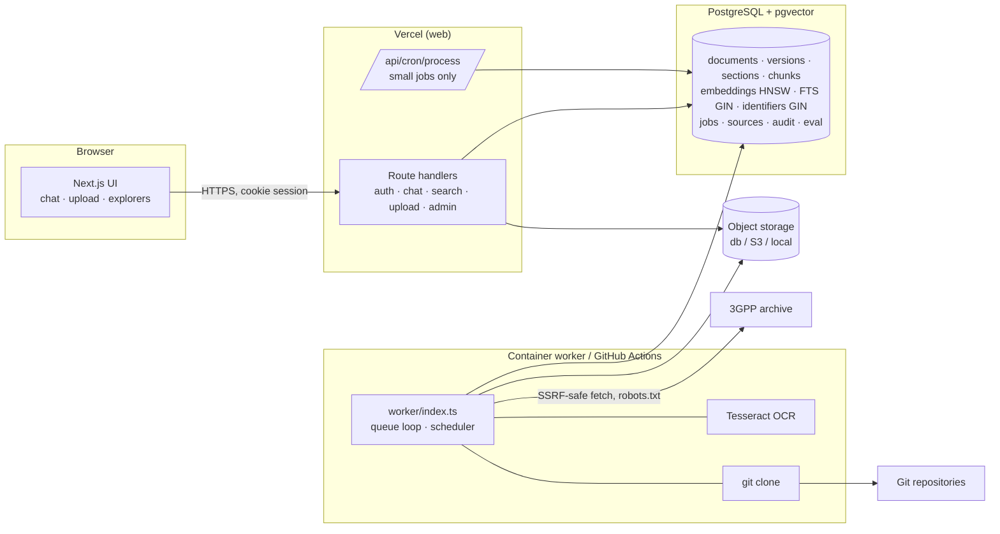

# Architecture

## Components

| Path | Responsibility |
|---|---|
| `src/app/(app)/*` | UI pages (Chat, Knowledge Base, Upload, Sources, Jobs, Search, Call Flows, API Explorer, Code Explorer, Evaluation, Settings, Admin) |
| `src/app/api/*` | HTTP API (see API.md). Every handler goes through `route()` for CSRF origin check, request ID and uniform errors |
| `src/lib/ingest/extract/*` | DOCX (mammoth with 3GPP style map), DOC, PDF (unpdf positioned text), HTML, Markdown/text → block stream |
| `src/lib/ingest/ocr.ts` | Tesseract OCR for figures and scanned pages (layout + sparse modes, confidence, cleanup) |
| `src/lib/ingest/chunk/*` | clause-aware document chunker, symbol-aware code chunker, structural OpenAPI chunker |
| `src/lib/ingest/pipeline.ts` | `index_version` job: fetch → extract → metadata → persist (transaction) → embed (cache) → verify → activate |
| `src/lib/ingest/queue.ts`, `runner.ts`, `handlers.ts` | Postgres job queue (`FOR UPDATE SKIP LOCKED`), retries with backoff, heartbeats, stale-job recovery, cancellation |
| `src/lib/sources/*` | source registry, 3GPP archive sync, git repository sync, robots.txt |
| `src/lib/embeddings/*` | provider abstraction (offline `local-hash`, any OpenAI-compatible endpoint), model registry, per-model HNSW index |
| `src/lib/retrieval/*` | query analysis and hybrid search |
| `src/lib/answer/*` | extractive answer composition and orchestration |
| `src/lib/flows/*` | evidence-derived and curated call flows, Mermaid rendering |
| `src/lib/openapi/*` | validator and deterministic code generator |
| `src/lib/telecom/*` | identifier extraction, 3GPP version/filename/cover parsing, domain tags |
| `worker/index.ts` | long-running worker (or `--once`), schedules due source syncs, health endpoint |

## Data model (db/migrations/0001_init.sql)

- **Tenancy**: `users`, `sessions` (token hashes only), `workspaces` (shared *Commons*, personal, team), `workspace_memberships` (owner/editor/viewer).
- **Provenance**: `document_sources` (authority tier, trust level, access method, licence, sync status) → `documents` (stable `doc_key`, e.g. `3gpp:23.502`, spec number/type, review status) → `document_versions` (immutable; checksum, version label, release, source URL, commit SHA, repo path, storage key, warnings, `is_current`).
- **Derived text**: `document_sections` (clause tree) → `document_chunks` (content, clause, heading path, pages, symbol, lines, identifiers[], flags[], denormalised filters, generated `tsvector`). Originals live separately in `document_blobs` / S3.
- **Vectors**: `embedding_models` (provider, model, dims, version, active flag), `embeddings` (untyped `vector`, partial HNSW index per model), `embedding_cache` (content-hash → vector), `embedding_usage` (tokens, cache hits, cost).
- **Structured entities**: `api_operations`, `api_schemas`, `code_symbols`, `abbreviations`.
- **Operations**: `ingestion_jobs`, `ingestion_job_events`, `source_sync_runs`, `repository_snapshots`, `retrieval_events`, `feedback`, `evaluation_cases`, `evaluation_runs`, `audit_events`, `rate_limits`.

Deleting a document cascades to versions, sections, chunks, embeddings and structured entities; unreferenced originals are removed from storage.

## Ingestion lifecycle

1. **Upload/URL/sync** — authenticated and authorised; extension, magic bytes and size validated; SHA-256 computed.
2. **Dedupe** — identical bytes already in the workspace → reported as duplicate, no new version, no new embeddings.
3. **Store** — original stored (db/S3/local) *or* an authorised source reference (3GPP archive URL + checksum, re-verified at index time).
4. **Queue** — one live `index_version` job per version (unique partial index ⇒ idempotent).
5. **Worker** — extract (OCR where needed) → parse 3GPP cover page (spec, version, date, release, title; mismatches recorded as warnings) → chunk → write sections/chunks/entities in one transaction (previous partial output for the version is deleted first, so retries are safe) → embed missing content hashes in batches with backoff → verify chunk and embedding counts → activate.
6. **Activate** — new version becomes current; the previous one is marked superseded and its chunks leave "latest" search but remain available for historical/release-specific queries. An *older* spec version indexed later never displaces a newer current version.
7. Failures retry with exponential backoff (max attempts per job); permanent errors (unsafe URL, unsupported format, checksum mismatch) fail immediately. Stale running jobs (no heartbeat for 15 min) are requeued.

## Retrieval and answering

1. **Analyse**: spec numbers, clauses (explicit or "6.1.3 of TS 23.502"), releases/versions, intents (definition, compare, procedure, failure, code, API, requirement), generation (LTE/5G), compare operands, identifiers including phrase-derived message names ("initial UE message" → `msg:initialuemessage`).
2. **Channels** (all with workspace, searchable, current/release and metadata filters):
   exact clause lookup → identifier overlap (GIN) → IDF-weighted FTS → vector cosine (active model only).
3. **Fuse** with weighted RRF (k = 60), then priors: authority tier, boilerplate/references/OCR/untrusted-text/generated-code penalties, intent-type boosts, spec match, heading-keyword match, generation mismatch.
4. **Dedupe** by content hash and ≤ 3 chunks per section; **expand** neighbours in the same section; enforce a token budget.
5. **Compose** (no generation): coverage-aware selection of verbatim sentences, explicit clause text, definitions, normative "shall" statements (Tier 1–2 only), numbered procedure steps, failure cases, identifier index, tables, OCR figures, code symbols, API operations, side-by-side comparison, version-conflict notes, evidence gaps.
6. **Refuse** when nothing relevant is retrieved, when an identifier-like term in the question does not exist in the corpus, or when the question contains instruction-injection text.
7. "Latest" mode searches current versions only; naming a release ("Rel-17") switches to historical mode restricted to that release, and gaps report releases that are not indexed.

## Security model

- Cookie sessions (`httpOnly`, `SameSite=Lax`, `Secure` in production); only peppered SHA-256 token hashes stored; bcrypt (cost 12) passwords; login timing equalised.
- CSRF: mutating requests must carry an `Origin`/`Referer` matching the host.
- Authorisation server-side on every request: workspace membership for reads, editor/owner/admin for writes, admin for sources/users/eval; requested workspace IDs are intersected with the caller's memberships.
- Shared-Commons uploads by viewers enter a review queue and are not searchable until approved; only admins can label uploads as official.
- URL ingestion: http(s) only, ports 80/443, no credentials, blocked internal hostnames, DNS resolved and every address must be globally routable unicast (blocks private, loopback, link-local/metadata, CGNAT, ULA, mapped IPv4), connect-time IP pinning against DNS rebinding, manual redirect following with re-validation, size and time limits, optional host allowlist, robots.txt respected.
- Documents and code are data: injected instructions are flagged (`suspicious_instructions`) and down-ranked; nothing retrieved can change permissions or behaviour; uploaded or cloned code is never executed (validators parse data only).
- Rate limits (Postgres fixed windows) on login, signup, chat, search, upload, URL ingestion and validation.
- Deny-by-default RLS on every table for non-owner roles (e.g. Supabase anon/authenticated via PostgREST); the app connects as owner and enforces isolation in its data-access layer.
- Errors return a request ID and a generic message; stack traces only go to server logs. Health checks report missing configuration names, never values.
